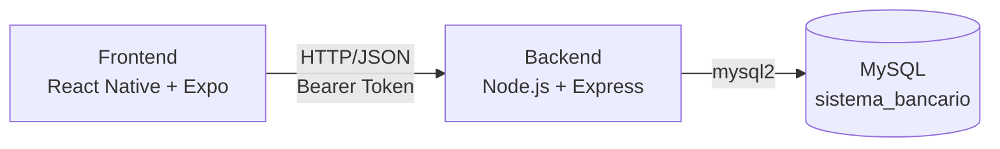

# Documentação — Parabon Bank

**Projeto Integrador**

O Parabon Bank é um projeto de banco digital desenvolvido como parte do Projeto Integrador. Sua arquitetura é composta por três camadas principais: aplicativo mobile, API de comunicação e banco de dados relacional.

## Arquitetura do sistema

O sistema utiliza uma arquitetura cliente-servidor, na qual o aplicativo mobile realiza requisições HTTP à API, responsável pelo processamento das operações e pela comunicação com o banco de dados MySQL.

## Documentação do projeto

| Documento | Descrição |
|---|---|
| [como-rodar.md](como-rodar.md) | **Guia de instalação e execução.** Apresenta os requisitos, as configurações necessárias e o passo a passo para executar o projeto completo. |
| [banco-de-dados.md](banco-de-dados.md) | Documentação da estrutura do banco de dados, incluindo tabelas, relacionamentos, regras de integridade, índices e dados iniciais. |
| [backend.md](backend.md) | Descrição da estrutura da API, suas rotas, variáveis de ambiente (`.env`), mecanismos de segurança e procedimentos de teste. |
| [frontend.md](frontend.md) | Documentação da aplicação mobile, contemplando telas, navegação, componentes, identidade visual e integração com a API. |

## Visão geral da arquitetura

O projeto está organizado em três camadas independentes, que se comunicam para garantir o funcionamento integrado do sistema.

| Camada | Diretório | Tecnologia | Porta |
|---|---|---|---|
| Banco de dados | `database/` | MySQL 8.0.16 ou superior | 3306 |
| Backend | `backend/` | Node.js 20.12+ e Express 5 | 3000 |
| Frontend | `frontend/` | Expo SDK 54 e React Native 0.81 | 8081 (Metro) |

## Orientações iniciais

Para configurar e executar o Parabon Bank, recomenda-se seguir a ordem de leitura da documentação:

1. **`como-rodar.md`:** configurar o ambiente e iniciar os serviços.
2. **`banco-de-dados.md`:** compreender a estrutura e a organização dos dados.
3. **`backend.md`:** conhecer a API e suas funcionalidades.
4. **`frontend.md`:** conhecer a interface mobile e sua integração com o backend.
