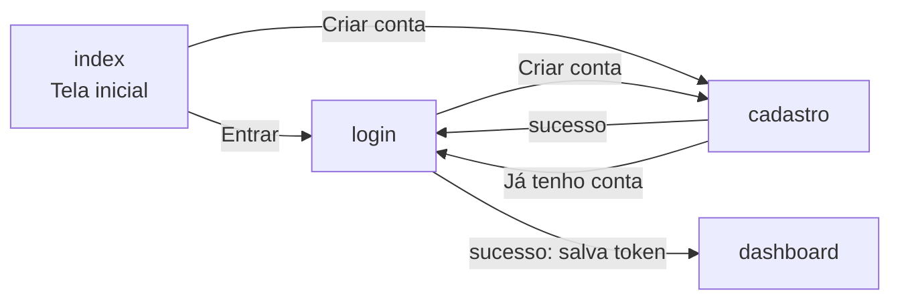

# Frontend — App Parabon Bank

Pasta: [`frontend/`](../frontend)

Aplicativo mobile feito com **React Native + Expo**, usando **Expo Router** (cada arquivo da pasta `app/` vira uma tela).

| Item | Versão |
|---|---|
| Expo SDK | 54 (`expo ~54.0.36`) |
| React / React Native | 19.1.0 / 0.81.5 |
| Expo Router | ~6.0.24 |
| expo-secure-store | ~15.0.8 (guarda o token de login no celular) |
| ESLint | 9 + `eslint-config-expo` |

> Documentação oficial da versão usada: https://docs.expo.dev/versions/v54.0.0/

---

## 1. Estrutura de pastas

```
frontend/
├── app/                  telas (rotas do Expo Router)
│   ├── _layout.js        Stack de navegação, sem cabeçalho
│   ├── index.js          tela inicial: botões "Entrar" e "Criar conta"
│   ├── login.js          login por e-mail ou CPF + senha
│   ├── cadastro.js       formulário de abertura de conta
│   └── dashboard.js      saldo, atalhos e últimas movimentações
├── components/
│   ├── Button.js         botão padrão (variantes primary / secondary, estado loading)
│   └── Input.js          campo de texto com rótulo e mensagem de erro
├── constants/
│   ├── colors.js         paleta oficial
│   └── theme.js          espaçamentos, fontes, bordas e raios
├── services/
│   └── api.js            comunicação com o backend
├── assets/images/        ícones e splash
├── app.json              configuração do Expo
├── eslint.config.js
└── package.json
```

## 2. Fluxo de telas



| Tela | Rota | O que faz | API usada |
|---|---|---|---|
| Início | `/` | Logo e dois botões | — |
| Login | `/login` | Valida e-mail/CPF e senha, salva o token e vai para o dashboard | `POST /api/auth/login` |
| Cadastro | `/cadastro` | Formulário com máscaras e validação campo a campo; ao concluir, vai para o login | `POST /api/auth/cadastro` |
| Dashboard | `/dashboard` | Saudação, saldo (com botão ocultar/mostrar), atalhos e extrato | `GET /api/clientes/me` e `GET /api/contas/:id/extrato?limit=50` |

### Campos do cadastro

Os nomes abaixo são os mesmos que o backend espera e devolve em `errors`:

| Campo | Máscara/regra |
|---|---|
| `fullName` | Nome completo |
| `cpf` | `000.000.000-00`, com dígitos verificadores válidos (vai sem máscara para a API) |
| `birthDate` | `DD-MM-AAAA`, pelo menos 18 anos |
| `email` | Formato de e-mail |
| `phone` | `(00) 00000-0000` (vai sem máscara) |
| `password` / `confirmPassword` | 8 a 64 caracteres, com maiúscula, minúscula, número e caractere especial |
| `pin` / `confirmPin` | 6 dígitos, sem sequência (`123456`) nem repetição (`111111`) |
| `termsAccepted` | Precisa estar marcado |

## 3. Comunicação com a API (`services/api.js`)

```js
const API_URL = "http://172.20.10.6:3000";
```

- `apiRequest(endpoint, options)`: faz o `fetch`, coloca `Content-Type: application/json` e, se houver token salvo, `Authorization: Bearer <token>`. Se a resposta não for 2xx, lança um `Error` com a `message` que o backend mandou.
- `saveToken(token)` / `removeToken()`: guardam e apagam o token no **SecureStore** (chave `parabon_token`).

> ⚠️ **`API_URL` precisa ser o IP do SEU computador na rede Wi-Fi.** No celular, `localhost` é o próprio celular, não o seu PC. Veja como descobrir o IP em [como-rodar.md](como-rodar.md#4-frontend-expo).

## 4. Identidade visual

Todas as cores ficam em [`constants/colors.js`](../frontend/constants/colors.js). Não escreva cores direto nas telas: use `theme.colors.*`.

| Nome | Hex | Uso |
|---|---|---|
| `burgundy` | `#5B0F18` | Cor principal, botões, marca |
| `wine` | `#7A1F2B` | Variação do vinho, destaques e erros |
| `roseDust` | `#D8A7A7` | Detalhes e elementos secundários |
| `cream` | `#F8F1E7` | Fundo das telas |
| `espresso` | `#1E1E1E` | Texto escuro |
| `white` | `#FFFFFF` | Texto sobre fundo escuro |

Espaçamentos (`theme.spacing`): `xs 4 · sm 8 · md 16 · lg 24 · xl 32`.
Fontes (`theme.fontSize`): `small 14 · medium 16 · large 20 · title 28`.

## 5. Componentes

**`<Button>`**

| Prop | Padrão | Descrição |
|---|---|---|
| `title` | — | Texto do botão |
| `onPress` | — | Ação ao tocar |
| `variant` | `"primary"` | `"primary"` (vinho) ou `"secondary"` (contorno) |
| `loading` | `false` | Mostra um spinner e desabilita |
| `disabled` | `false` | Desabilita |

**`<Input>`**: `label`, `value`, `onChangeText`, `onBlur`, `onEndEditing`, `placeholder`, `secureTextEntry`, `keyboardType`, `autoCapitalize` e `error` (a borda fica vermelha e a mensagem aparece abaixo do campo).

## 6. Comandos

Dentro de `frontend/`:

| Comando | O que faz |
|---|---|
| `npm install` | Instala as dependências |
| `npx expo start` (ou `npm start`) | Inicia o Metro e mostra o QR Code |
| `npm run android` | Abre no emulador Android |
| `npm run web` | Abre no navegador (veja a limitação abaixo) |
| `npm run lint` | Verifica o código com ESLint |

## 7. Pendências e limitações conhecidas

- **Atalhos do dashboard** (Pix, Extrato, Face Payment) ainda não fazem nada (`onPress={() => {}}`).
- **Logout**: `removeToken()` existe, mas nenhuma tela chama. O backend já tem `POST /api/auth/logout`.
- **Navegador (Expo web)**: o `expo-secure-store` só funciona em Android e iOS, então login e dashboard devem ser testados no **Expo Go** ou em um emulador.
- **`npm run reset-project`**: o script `scripts/reset-project.js` não existe mais no projeto. **Não rode** esse comando.
- O `README.md` da pasta `frontend` ainda é o texto padrão do `create-expo-app`.
